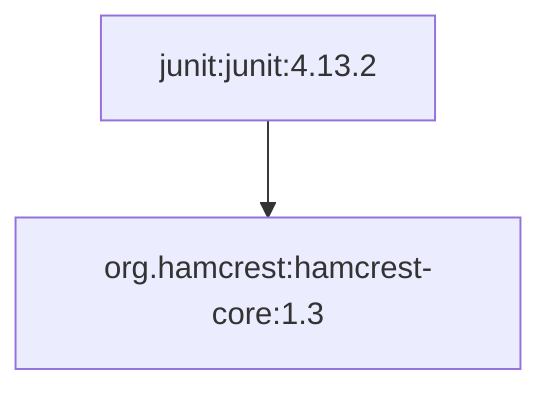
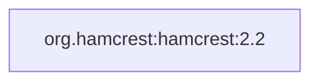
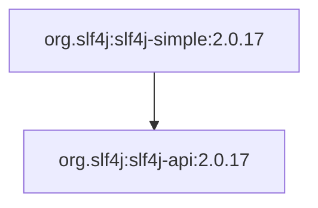

# Домашняя работа №2

**Вариант 22. Визуализация графа зависимостей Java Maven.**

```bash
cd homework_2
```

## Этап 1. Минимальный прототип с конфигурацией

`argparse` принимает имя пакета, адрес репозитория или путь к файлу,
флаг тестового режима и флаг ASCII-дерева.

```bash
bash run.sh --package junit:junit:4.13.2 \
  --repository https://repo.maven.apache.org/maven2/ --ascii-tree --mode config
```

```text
package=junit:junit:4.13.2
repository=https://repo.maven.apache.org/maven2/
test_repository=false
ascii_tree=true
```

```bash
bash run.sh --package junit --repository https://repo.maven.apache.org/maven2/ --mode config
bash run.sh --package junit:junit:4.13.2 --repository ftp://example.org --mode config
bash run.sh --package A --repository examples/chain.txt --test-repository=true --mode config
bash run.sh --package junit:junit:4.13.2 \
  --repository https://repo.maven.apache.org/maven2/ --ascii-tree=true --mode config
```

Фрагменты вывода. Код завершения в каждом случае равен 2.

```text
Ошибка: --package: ожидается groupId:artifactId[:version]
Ошибка: --repository: нужен HTTP(S) URL
Ошибка: --test-repository: флаг передаётся без значения
Ошибка: --ascii-tree: флаг передаётся без значения
```

## Этап 2. Сбор данных

Программа скачивает POM-файл через `urllib.request` и читает зависимости через `xml.etree.ElementTree`.

```bash
bash run.sh --package junit:junit:4.13.2 --repository https://repo.maven.apache.org/maven2/ --mode direct
```

```text
org.hamcrest:hamcrest-core:1.3
org.hamcrest:hamcrest-library:1.3
```

`hamcrest-library` нужна для тестов JUnit.

## Этап 3. Основные операции

Тестовый режим читает связи из файла. Обход в глубину (DFS) использует
стек вместо рекурсии. Ссылка на пакет,
который ещё в стеке обхода, означает цикл.

```bash
bash run.sh --package A --repository examples/chain.txt --test-repository --mode graph
bash run.sh --package A --repository examples/cycle.txt --test-repository --mode graph
```

```text
A: B
B: C
C:

A: B
B: C
C: A
Цикл: C -> A
```

## Этап 4. Дополнительные операции

Пакет попадает в список после своих зависимостей. При цикле порядок построить нельзя.

```bash
bash run.sh --package A --repository examples/diamond.txt --test-repository --mode order
bash run.sh --package A --repository examples/cycle.txt --test-repository --mode order
```

```text
D
B
C
Ошибка: порядок загрузки невозможен, есть цикл: C -> A
```

```bash
bash run.sh --package junit:junit:4.13.2 --repository https://repo.maven.apache.org/maven2/ --mode order
mvn -f examples/maven/junit.xml dependency:build-classpath dependency:tree
```

Программа выводит `org.hamcrest:hamcrest-core:1.3`. В classpath Maven
сначала стоит `junit-4.13.2.jar`, затем `hamcrest-core-1.3.jar`.
Classpath задаёт порядок поиска классов. `order` показывает порядок обхода.

## Этап 5. Визуализация

Программа сохраняет схему Mermaid и открывает граф в браузере.
Флаг `--ascii-tree` выводит дерево в терминале.

```bash
bash run.sh --package junit:junit:4.13.2 --repository https://repo.maven.apache.org/maven2/ --ascii-tree
```



```bash
bash run.sh --package org.hamcrest:hamcrest:2.2 --repository https://repo.maven.apache.org/maven2/ --ascii-tree
```



```bash
bash run.sh --package org.slf4j:slf4j-simple:2.0.17 --repository https://repo.maven.apache.org/maven2/ --ascii-tree
```



ASCII-деревья из вывода программы

```text
junit:junit:4.13.2
`-- org.hamcrest:hamcrest-core:1.3

org.hamcrest:hamcrest:2.2

org.slf4j:slf4j-simple:2.0.17
`-- org.slf4j:slf4j-api:2.0.17
```

```bash
mvn -f examples/maven/hamcrest.xml dependency:tree
mvn -f examples/maven/slf4j.xml dependency:tree
```

Деревья JUnit, Hamcrest и SLF4J Simple совпали с выводом Maven.

## Тестирование

```bash
python3 -B -m unittest discover -s tests -q
```

Все 15 тестов прошли (`OK`).

## Вывод

Программа строит граф зависимостей из POM и находит циклы.
Для графа без циклов программа показывает порядок зависимостей.
