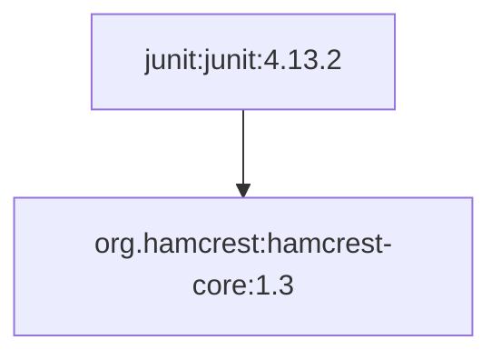
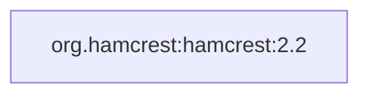
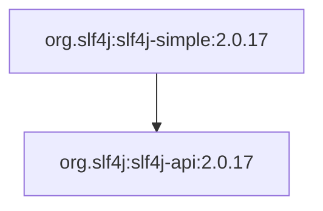

# Домашняя работа №2

**Вариант 22. Визуализация графа зависимостей Java Maven.**

Все примеры выполняются из папки `homework_2`.

```bash
cd homework_2
```

## Этап 1. Минимальный прототип с конфигурацией

Программа принимает параметры через `argparse`. Параметр `--package`
задаёт пакет, а `--repository` задаёт адрес Maven-репозитория или путь
к файлу. Флаг `--test-repository` включает работу с файлом, а
`--ascii-tree` добавляет текстовое дерево в режиме визуализации.
Режим `config` показывает значения этих четырёх настроек.

```bash
bash run.sh --package junit:junit:4.13.2 \
  --repository https://repo.maven.apache.org/maven2/ --ascii-tree --mode config
```

```text
package=junit:junit:4.13.2
repository=https://repo.maven.apache.org/maven2/
test_repository=false
ascii_tree=true
```

При неверном имени пакета программа сообщает об ожидаемом формате.

```bash
bash run.sh --package junit --repository https://repo.maven.apache.org/maven2/ --mode config
echo $?
```

```text
Ошибка: --package: ожидается groupId:artifactId[:version]
Справка: --help
2
```

Адрес репозитория должен начинаться с `http://` или `https://`.

```bash
bash run.sh --package junit:junit:4.13.2 --repository ftp://example.org --mode config
echo $?
```

```text
Ошибка: --repository: нужен HTTP(S) URL
Справка: --help
2
```

Флаг тестового режима передаётся без значения.

```bash
bash run.sh --package A --repository examples/chain.txt --test-repository=true --mode config
echo $?
```

```text
Ошибка: --test-repository: флаг передаётся без значения
Справка: --help
2
```

Флаг вывода дерева тоже передаётся без значения.

```bash
bash run.sh --package junit:junit:4.13.2 \
  --repository https://repo.maven.apache.org/maven2/ --ascii-tree=true --mode config
echo $?
```

```text
Ошибка: --ascii-tree: флаг передаётся без значения
Справка: --help
2
```

## Этап 2. Сбор данных

В файле POM в формате XML записаны настройки пакета Maven
и его зависимости. Программа загружает POM через
`urllib.request` и читает его через `xml.etree.ElementTree`. Оба модуля
входят в стандартную библиотеку Python.

```bash
bash run.sh --package junit:junit:4.13.2 --repository https://repo.maven.apache.org/maven2/ --mode direct
```

```text
org.hamcrest:hamcrest-core:1.3
org.hamcrest:hamcrest-library:1.3
```

Режим `direct` показывает все прямые зависимости из POM. Поэтому в
списке есть `hamcrest-library`, которая нужна для тестов самого JUnit.

## Этап 3. Основные операции

Граф строится обходом в глубину (DFS) без рекурсии. Программа берёт из
стека пакет и добавляет туда его зависимости. Для тестового файла каждый
пакет раскрывается один раз, но все связи с ним остаются в графе.

**Цепочка**

```bash
bash run.sh --package A --repository examples/chain.txt --test-repository --mode graph
```

```text
A: B
B: C
C:
```

**Ромб**

```bash
bash run.sh --package A --repository examples/diamond.txt --test-repository --mode graph
```

```text
A: B C
B: D
D:
C: D
```

**Граф с циклом**

```bash
bash run.sh --package A --repository examples/cycle.txt --test-repository --mode graph
```

```text
A: B
B: C
C: A
Цикл: C -> A
```

При проверке циклов программа обнаруживает, что `C` ссылается на
`A`, который ещё находится в стеке обхода.

## Этап 4. Дополнительные операции

При обходе программа добавляет пакет в список только после его
зависимостей. Поэтому сначала выводится то, что нужно для работы других
пакетов. Начальный пакет в список не входит.

**Цепочка**

```bash
bash run.sh --package A --repository examples/chain.txt --test-repository --mode order
```

```text
C
B
```

**Ромб**

```bash
bash run.sh --package A --repository examples/diamond.txt --test-repository --mode order
```

```text
D
B
C
```

При цикле построить порядок нельзя.

```bash
bash run.sh --package A --repository examples/cycle.txt --test-repository --mode order
echo $?
```

```text
Ошибка: порядок загрузки невозможен, есть цикл: C -> A
1
```

Для JUnit программа показывает, какая библиотека нужна до обработки
самого пакета.

```bash
bash run.sh --package junit:junit:4.13.2 --repository https://repo.maven.apache.org/maven2/ --mode order
```

```text
org.hamcrest:hamcrest-core:1.3
```

Maven 3.9.11 формирует список JAR-файлов для поиска классов (classpath).
Для этого используется [проверочный POM JUnit](homework_2/examples/maven/junit.xml).

```bash
mvn -f examples/maven/junit.xml dependency:build-classpath
```

Фрагмент фактического вывода с сокращёнными путями

```text
…/junit-4.13.2.jar:…/hamcrest-core-1.3.jar
```

В classpath JUnit идёт перед Hamcrest Core. Вывод `order` показывает
логический порядок обхода зависимостей. Фактический порядок скачивания
файлов по classpath определить нельзя.

## Этап 5. Визуализация

Программа сохраняет схему Mermaid в `graph.mmd` и открывает граф
в браузере через `graph.html`. Граф строится для проекта, который
подключает библиотеку, поэтому её собственные тестовые зависимости
в дерево не входят.

### JUnit 4.13.2

```bash
bash run.sh --package junit:junit:4.13.2 \
  --repository https://repo.maven.apache.org/maven2/ --ascii-tree --output output/junit
```



Фрагмент вывода программы с ASCII-деревом

```text
junit:junit:4.13.2
`-- org.hamcrest:hamcrest-core:1.3
```

JUnit зависит от Hamcrest Core.

### Hamcrest 2.2

```bash
bash run.sh --package org.hamcrest:hamcrest:2.2 \
  --repository https://repo.maven.apache.org/maven2/ --ascii-tree --output output/hamcrest
```



Фрагмент вывода программы с ASCII-деревом

```text
org.hamcrest:hamcrest:2.2
```

У Hamcrest 2.2 нет зависимостей в графе.

### SLF4J Simple 2.0.17

```bash
bash run.sh --package org.slf4j:slf4j-simple:2.0.17 \
  --repository https://repo.maven.apache.org/maven2/ --ascii-tree --output output/slf4j
```



Фрагмент вывода программы с ASCII-деревом

```text
org.slf4j:slf4j-simple:2.0.17
`-- org.slf4j:slf4j-api:2.0.17
```

SLF4J Simple зависит от SLF4J API той же версии.

### Сравнение с Maven

У каждого проверочного POM одна зависимость. Ниже приведены фрагменты
фактического вывода Maven с деревьями зависимостей.

```bash
mvn -f examples/maven/junit.xml dependency:tree
```

```text
[INFO] demo:junit-check:jar:1
[INFO] \- junit:junit:jar:4.13.2:compile
[INFO]    \- org.hamcrest:hamcrest-core:jar:1.3:compile
```

```bash
mvn -f examples/maven/hamcrest.xml dependency:tree
```

```text
[INFO] demo:hamcrest-check:jar:1
[INFO] \- org.hamcrest:hamcrest:jar:2.2:compile
```

```bash
mvn -f examples/maven/slf4j.xml dependency:tree
```

```text
[INFO] demo:slf4j-check:jar:1
[INFO] \- org.slf4j:slf4j-simple:jar:2.0.17:compile
[INFO]    \- org.slf4j:slf4j-api:jar:2.0.17:compile
```

Верхний узел `demo` обозначает проверочный проект. Ветки выбранных
библиотек совпали со всеми тремя графами программы.

## Тестирование

```bash
python3 -B -m unittest discover -s tests -v
```

Фрагмент вывода одного запуска

```text
Ran 15 tests in 1.443s

OK
```

Тесты проверяют параметры, загрузку и разбор POM, графы с циклами,
порядок зависимостей и вывод диаграмм.
