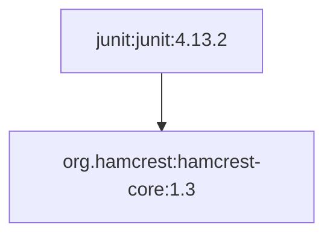
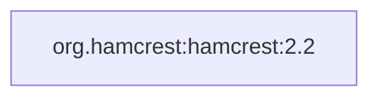
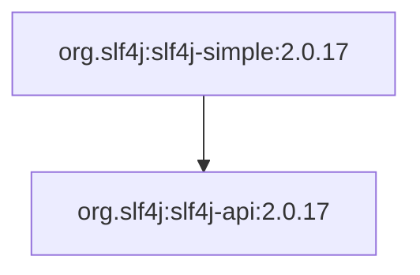

# Домашняя работа №2

**Вариант 22.** Визуализация графа зависимостей Java Maven.

Команды выполняются из папки `homework_2`. Для запуска программы нужен
Python 3.9 или новее. Maven нужен только для сравнения результатов.

```bash
repo=https://repo.maven.apache.org/maven2/
```

## Этап 1. Настройка программы

На первом этапе нужно принять параметры командной строки, показать их
значения и обработать ошибки ввода. Я использовала `argparse` для настройки CLI.
Программа проверяет имя пакета и адрес репозитория или путь к файлу.

```bash
bash run.sh --package junit:junit:4.13.2 --repository "$repo" \
  --ascii-tree --mode config
```

```text
package=junit:junit:4.13.2
repository=https://repo.maven.apache.org/maven2/
test_repository=false
ascii_tree=true
```

Следующие четыре команды проверяют обработку ошибок.

```bash
bash run.sh --mode config --package junit --repository "$repo"
bash run.sh --mode config --package junit:junit:4.13.2 --repository ftp://example.org
bash run.sh --mode config --package A --repository examples/chain.txt --test-repository=true
bash run.sh --mode config --package junit:junit:4.13.2 --repository "$repo" --ascii-tree=true
```

Во всех четырёх случаях получен код 2 и сообщение с именем ошибочного
параметра. Флаги `--test-repository` и `--ascii-tree` передаются без
значений. Режим `config` позволяет проверить настройки до загрузки POM.

## Этап 2. Прямые зависимости

На втором этапе нужно самостоятельно получить прямые зависимости Maven-пакета.
Программа составляет путь к POM из координат пакета, загружает его через
`urllib.request` и разбирает XML через `ElementTree`. При обработке POM
учитываются родительская модель, свойства и управляемые версии.

```bash
bash run.sh --package junit:junit:4.13.2 --repository "$repo" --mode direct
```

```text
org.hamcrest:hamcrest-core:1.3
org.hamcrest:hamcrest-library:1.3
```

Из POM JUnit получены два прямых объявления. `hamcrest-library` имеет область
`test`. Этот режим показывает все прямые объявления, включая тестовые.

## Этап 3. Построение графа

На третьем этапе нужно построить граф транзитивных зависимостей с помощью
DFS без рекурсии. Программа кладёт вершины в стек, сохраняет связи и при обходе
отмечает рёбра к вершинам, которые ещё находятся в стеке. Из Maven POM в
граф потребителя входят зависимости с областями `compile` и `runtime`
с учётом `optional` и `exclusions`.

```bash
for file in chain diamond cycle; do
  bash run.sh --package A --repository "examples/$file.txt" \
    --test-repository --mode graph
done
```

В цепочке получены связи `A → B → C`. В ромбе обе ветви ведут к `D`.
При обходе третьего примера программа завершила построение графа и вывела
`Цикл: C -> A`. Стек позволяет обработать общий узел и обнаружить
циклическую ссылку.

## Этап 4. Порядок загрузки

На четвёртом этапе нужно вывести зависимости в порядке загрузки. В список попадают
вершины в порядке завершения DFS. Так зависимость появляется раньше
пакета, который её использует. Корневой пакет в список не входит.

```bash
for file in chain diamond cycle; do
  bash run.sh --package A --repository "examples/$file.txt" \
    --test-repository --mode order
done
bash run.sh --package junit:junit:4.13.2 --repository "$repo" --mode order
```

Для цепочки получен порядок `C, B`, для ромба `D, B, C`. Граф с циклом
дал ошибку и код 1. Для JUnit программа вывела `hamcrest-core:1.3`.
При сравнении в Maven 3.9.11 команда `dependency:build-classpath` поставила
JAR JUnit перед JAR Hamcrest Core. Classpath задаёт порядок поиска
классов, а порядок DFS показывает, какие зависимости нужны
до обработки пакета.

## Этап 5. Визуализация

На пятом этапе нужно показать графы трёх реальных пакетов и сравнить их с Maven.
Программа записывает Mermaid в `graph.mmd`, открывает изображение в
`graph.html` и выводит ASCII-дерево при включённом флаге `--ascii-tree`.

```bash
demo="$(mktemp -d)"
for package in junit:junit:4.13.2 org.hamcrest:hamcrest:2.2 org.slf4j:slf4j-simple:2.0.17; do
  IFS=: read -r group artifact version <<< "$package"
  bash run.sh --package "$package" --repository "$repo" --ascii-tree \
    --output "$demo/$artifact"
done
```







В ASCII-дереве JUnit показан Hamcrest Core, в дереве SLF4J Simple
показан SLF4J API. У Hamcrest 2.2 дерево состоит из одной вершины.
HTML-страницы всех трёх примеров отобразили диаграммы в браузере.

Для сравнения я создала проверочный POM с одной зависимостью на каждый
пакет и выполнила `dependency:tree` и `dependency:build-classpath`.

```bash
plugin=org.apache.maven.plugins:maven-dependency-plugin:3.8.1
for package in junit:junit:4.13.2 org.hamcrest:hamcrest:2.2 org.slf4j:slf4j-simple:2.0.17; do
  IFS=: read -r group artifact version <<< "$package"
  mkdir -p "$demo/$artifact"
  pom="$demo/$artifact/pom.xml"
  cat > "$pom" <<EOF
<project>
  <modelVersion>4.0.0</modelVersion>
  <groupId>demo</groupId><artifactId>check</artifactId><version>1</version>
  <dependencies><dependency>
    <groupId>$group</groupId><artifactId>$artifact</artifactId><version>$version</version>
  </dependency></dependencies>
</project>
EOF
  mvn -B -f "$pom" "$plugin:tree" "$plugin:build-classpath"
done
```

После исключения корня проверочного проекта дерево Maven совпало с
каждым из трёх графов. Режим `direct` для SLF4J Simple дополнительно
показывает тестовый JUnit и второе объявление SLF4J API с типом
`test-jar`. В граф потребителя эти тестовые зависимости не входят.

## Проверка и вывод

```bash
python3 -B -m unittest discover -s tests -v
```

Все 15 тестов прошли. Проверены параметры, чтение POM, тестовые графы,
циклы, порядок загрузки, Mermaid и ASCII-дерево.
