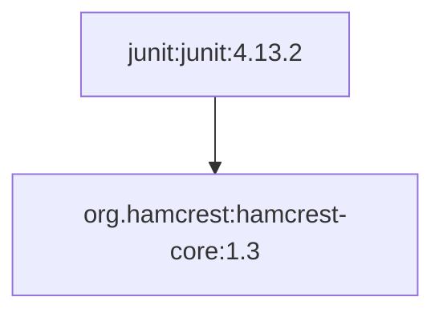
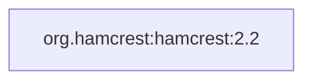
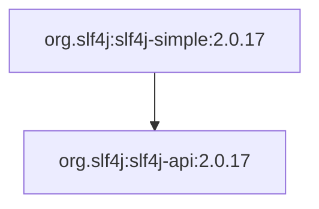

# Домашняя работа №2

**Вариант:** №22

## Этап 1. Минимальный прототип с конфигурацией

**Цель:** создать CLI-приложение для настройки инструмента визуализации
графа зависимостей Java Maven.

### 1. Параметры командной строки

Для обработки аргументов использован модуль `argparse`.
Программа принимает имя пакета, адрес репозитория или путь к тестовому файлу,
флаг тестового режима и флаг вывода ASCII-дерева.
Параметры `--package` и `--repository` обязательны.

### 2. Проверка параметров

Координаты Maven задаются в формате `groupId:artifactId[:version]`,
например `junit:junit:4.13.2`. В тестовом режиме имя пакета состоит
из одной большой латинской буквы.

В адресе репозитория проверяются схема HTTP(S), имя сервера и порт.
Для локального файла проверяются его наличие и доступность для чтения.
При неверных аргументах выводится сообщение об ошибке с кодом завершения 2.

### 3. Вывод конфигурации

Настройки выводятся в формате ключ-значение. Для проверки этого этапа
используется режим `config`:

```bash
bash run.sh --package junit:junit:4.13.2 \
  --repository https://repo.maven.apache.org/maven2/ \
  --ascii-tree --mode config
```

Результат:

```text
package=junit:junit:4.13.2
repository=https://repo.maven.apache.org/maven2/
test_repository=false
ascii_tree=true
```

### 4. Обработка ошибок

Проверены отсутствие обязательных аргументов, неверные координаты,
неподдерживаемая схема URL, неправильный порт, отсутствующий файл,
неизвестные опции и передача значений флагам.

| Проверка | Результат |
| --- | --- |
| Отсутствует `--package` | Сообщение об обязательном параметре. |
| Имя `/bad` | Сообщение о неверном формате координат. |
| Адрес с `ftp://` | Сообщение о необходимости HTTP(S). |
| Файл `missing.txt` | Сообщение об отсутствии файла. |
| `--ascii-tree=maybe` | Сообщение о том, что флаг не принимает значение. |

### Вывод по этапу 1

Реализованы приём, проверка и вывод четырёх настроек.
Проверки первого этапа включают 15 тестов CLI.

## Этап 2. Сбор данных

**Цель:** получить прямые зависимости пакета из репозитория Maven.

### 1. Получение и разбор POM

Модуль `maven.py` загружает POM через `urllib.request`.
Путь к файлу строится из координат пакета. Для JUnit это
`junit/junit/4.13.2/junit-4.13.2.pom`.
XML разбирается модулем `xml.etree.ElementTree`.
Готовые средства получения зависимостей не используются.

При разборе учитываются родительский POM, свойства и раздел
`dependencyManagement`, включая импорт BOM. Если версия пакета
не указана, берётся значение release из `maven-metadata.xml`.

### 2. Демонстрация работы

```bash
bash run.sh --package junit:junit:4.13.2 \
  --repository https://repo.maven.apache.org/maven2/ --mode direct
```

Получены прямые зависимости:

```text
org.hamcrest:hamcrest-core:1.3
org.hamcrest:hamcrest-library:1.3
```

Режим `direct` выводит все прямые объявления POM, в том числе тестовые.
Для ошибок сети, повреждённого XML, неизвестных свойств и отсутствующей
версии предусмотрены сообщения об ошибке.

### Вывод по этапу 2

Прямые зависимости JUnit получены из Maven Central.
Разбор POM проверен тестами на наследование, свойства и управление версиями.

## Этап 3. Основные операции

**Цель:** построить граф с транзитивными зависимостями алгоритмом DFS
без рекурсии.

### 1. Построение графа

Функция `build_graph` использует стек и множество посещённых состояний.
После получения прямых зависимостей обход продолжается для каждого
связанного пакета. Общие вершины не загружаются повторно в том же контексте.
Обратные рёбра сохраняются и отмечаются при поиске циклов.

Для Maven строится граф зависимостей библиотеки, необходимых потребителю.
В него включаются области compile и runtime. Тестовые, provided,
system и optional-зависимости исключаются. Учитываются exclusions
на соответствующем пути обхода.

### 2. Тестовый репозиторий

Локальный граф задаётся списком смежности:

```text
A: B C
B: D
C: D
D:
```

Каждая вершина объявляется отдельной строкой. Пустой список означает лист.
Вершины, недостижимые из выбранного корня, в результат не включаются.

### 3. Демонстрация работы

```bash
bash run.sh --package A --repository examples/cycle.txt \
  --test-repository --mode graph
```

Результат:

```text
A: B
B: C
C: A
Цикл: C -> A
```

Дополнительно проверены цепочка, ромб, петля и граф из одной вершины.
Цепочка из 2500 рёбер обработана без рекурсивных вызовов.

### Вывод по этапу 3

Построен транзитивный граф. Циклические зависимости обнаруживаются
и не приводят к бесконечному обходу.

## Этап 4. Дополнительные операции

**Цель:** определить порядок загрузки зависимостей.

### 1. Определение порядка

Функция `dependency_order` использует порядок завершения DFS.
Каждая зависимость выводится раньше пакета, которому она нужна.
Сам анализируемый пакет в список не входит. Общие зависимости
выводятся один раз. При цикле программа сообщает, что порядок невозможен.

### 2. Проверка на тестовых графах

```bash
bash run.sh --package A --repository examples/diamond.txt \
  --test-repository --mode order
```

Результат:

```text
D
B
C
```

D предшествует B и C, поскольку оба пакета от него зависят.
Для цепочки получен порядок C, B. Для листа выводится сообщение
«Зависимостей нет.», для цикла возвращается ошибка с кодом 1.

### 3. Сравнение с Maven

Для сравнения использованы Maven 3.9.11 и Java 26.0.1.
В проверочном POM объявлена зависимость `junit:junit:4.13.2`.
Команды `dependency:tree` и `dependency:build-classpath`
завершились с результатом `BUILD SUCCESS`.

Программа вывела зависимость `org.hamcrest:hamcrest-core:1.3`.
Её наличие подтверждено деревом Maven. В classpath Maven сначала
перечислен JUnit, затем Hamcrest. Этот список не задаёт порядок загрузки:
наш алгоритм размещает зависимости перед потребителями, а порядок
скачивания Maven также зависит от кеша и параллельных запросов.

### Вывод по этапу 4

Для ациклических графов получен порядок зависимостей.
Результат проверен на локальных примерах и сопоставлен с выводом Maven.

## Этап 5. Визуализация

**Цель:** сформировать диаграмму Mermaid и ASCII-дерево.

### 1. Представление графа

Функция `mermaid_text` создаёт описание вершин и рёбер на языке Mermaid.
Подписи содержат координаты пакетов. Текст сохраняется в `graph.mmd`.
HTML-страница `graph.html` использует Mermaid для построения SVG-изображения
и передаётся браузеру для открытия.

Флаг `--ascii-tree` добавляет дерево в вывод терминала.
Общие вершины помечаются как `[уже показан]`, обратные рёбра как `[цикл]`.

### 2. Примеры для трёх пакетов

Получены следующие диаграммы:







ASCII-представление тех же графов:

```text
junit:junit:4.13.2
`-- org.hamcrest:hamcrest-core:1.3

org.hamcrest:hamcrest:2.2

org.slf4j:slf4j-simple:2.0.17
`-- org.slf4j:slf4j-api:2.0.17
```

### 3. Сравнение со штатной визуализацией Maven

Для каждого пакета создан POM с одной зависимостью.
Команда `dependency:tree` показала следующие деревья:

```text
demo:comparison:jar:1
\- junit:junit:jar:4.13.2:compile
   \- org.hamcrest:hamcrest-core:jar:1.3:compile

demo:comparison:jar:1
\- org.hamcrest:hamcrest:jar:2.2:compile

demo:comparison:jar:1
\- org.slf4j:slf4j-simple:jar:2.0.17:compile
   \- org.slf4j:slf4j-api:jar:2.0.17:compile
```

Без корня проверочного проекта `comparison` состав вершин и рёбер
совпал для всех трёх пакетов. Maven дополнительно выводит тип JAR и scope.
Программа не выполняет выбор одной версии по правилу nearest-wins,
не активирует профили и не разрешает диапазоны версий, поэтому для
более сложных POM возможны различия.

### 4. Проверка

Выполнены 44 автоматических теста, результат `OK`.
Проверены параметры, POM, наследование, свойства, BOM, исключения,
графы, циклы, порядок загрузки и формирование представлений.
Интеграционные тесты запускают CLI с локальным HTTP-сервером.

Файлы Mermaid и HTML созданы. В тесте открытия браузера проверена
передача адреса HTML-страницы. Фактический показ локальной страницы
на экране не подтверждён из-за запрета протокола `file://`
в проверочном браузере.

### Вывод по этапу 5

Сформированы Mermaid-диаграммы и ASCII-деревья для трёх пакетов.
Их связи совпали с результатами штатного дерева Maven.

## Вывод

В ходе работы разработан инструмент анализа зависимостей Java Maven.
Реализованы получение данных из POM, построение графа без рекурсии,
обработка циклов, определение порядка загрузки и визуализация.
Команды проверок и результаты приведены в [протоколе](homework_2/tests/RESULTS.md).
