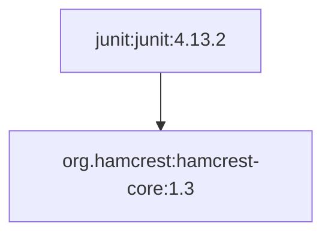
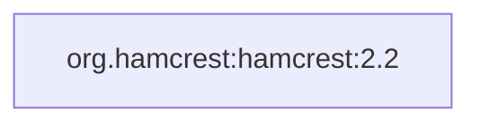
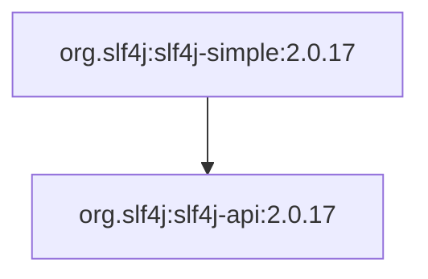

# Домашняя работа №2

**Вариант:** №22

Итоговая версия включает все пять этапов. Раздел первого этапа описывает
его исходное поведение; в текущей программе оно повторяется через
`--mode config`. По умолчанию запускается визуализация.
Актуальные команды и все параметры собраны в [README](homework_2/README.md).

## Этап 1. Минимальный прототип с конфигурацией

**Цель:** Создать минимальное CLI-приложение для настройки инструмента
визуализации графа зависимостей менеджера пакетов Java Maven.

### 1. Параметры командной строки

Программа реализована на языке Python с использованием стандартной
библиотеки. Для обработки параметров применяется модуль `argparse`.
По заданию первого этапа настраиваются четыре параметра:
имя анализируемого пакета, URL репозитория или путь к тестовому файлу,
тестовый режим и режим вывода ASCII-дерева.

Работа размещена в папке `homework_2`. Исходники и тесты первой
домашней работы сохранены отдельно.

В файле `homework_2/src/depgraph/config.py` описаны опции:

```python
parser.add_argument(
    "--package", required=True,
    help="groupId:artifactId[:version]; в тестовом режиме буква A-Z",
)
parser.add_argument(
    "--repository", required=True,
    help="HTTP(S) URL или путь к файлу при --test-repository",
)
parser.add_argument(
    "--test-repository", action="store_true",
    help="использовать локальный тестовый файл; значение не требуется",
)
parser.add_argument(
    "--ascii-tree", action="store_true",
    help="сохранить настройку ASCII-дерева; значение не требуется",
)
```

Параметры `--package` и `--repository` обязательны.
Флаги по умолчанию выключены, их наличие включает соответствующий режим.
Значения после флагов не передаются.

### 2. Проверка полученных параметров

Для пакетов Maven принят формат `groupId:artifactId[:version]`.
Например, `junit:junit:4.13.2`. Части координат должны быть непустыми
и не содержать пробелов. В тестовом режиме имя пакета задаётся одной
большой латинской буквой от A до Z.

В обычном режиме параметр `--repository` должен содержать HTTP(S) URL.
Проверяются имя сервера, порт и синтаксис адреса.
В тестовом режиме этот параметр должен указывать на существующий файл,
который можно открыть для чтения.

Проверки выполняются до вывода настроек:

```python
def parse_args(argv=None):
    """Прочитать и проверить настройки первого этапа."""
    parser = build_parser()
    config = parser.parse_args(argv)
    try:
        validate_package(config.package, config.test_repository)
        if config.test_repository:
            validate_file(config.repository)
        else:
            validate_url(config.repository)
    except ValueError as error:
        parser.error(str(error))
    return config
```

При неправильном значении выводится сообщение об ошибке.
Программа завершается с кодом 2, частичный вывод настроек отсутствует.

### 3. Вывод конфигурации

На первом этапе все четыре настройки выводятся в формате ключ-значение.
Для этого в файле `homework_2/src/depgraph/cli.py` реализована функция:

```python
def main(argv=None):
    """Вывести четыре проверенные настройки в формате ключ=значение."""
    config = parse_args(argv)
    print(f"package={config.package}")
    print(f"repository={config.repository}")
    print(f"test_repository={str(config.test_repository).lower()}")
    print(f"ascii_tree={str(config.ascii_tree).lower()}")
    return 0
```

Точка входа находится в `homework_2/src/main.py`.
Для запуска создан отдельный скрипт `homework_2/run.sh`.
Он передаёт параметры программе и находит исходный файл независимо
от текущего каталога.

### 4. Демонстрация работы

Все следующие команды выполнены из папки `homework_2`.

Проверка параметров для репозитория Maven:

```bash
bash run.sh --package junit:junit:4.13.2 --repository https://repo.maven.apache.org/maven2/ --ascii-tree
```

Результат:

```text
package=junit:junit:4.13.2
repository=https://repo.maven.apache.org/maven2/
test_repository=false
ascii_tree=true
```

Проверка тестового режима:

```bash
bash run.sh --package A --repository examples/repository.txt --test-repository
```

Результат:

```text
package=A
repository=examples/repository.txt
test_repository=true
ascii_tree=false
```

В обоих случаях программа завершилась с кодом 0.
Содержимое тестового файла не разбирается. Зависимости не загружаются,
граф и ASCII-дерево на этом этапе не строятся.

### 5. Обработка ошибок

Проверено отсутствие обязательных параметров и их значений.
Например, запуск без имени пакета:

```bash
bash run.sh --repository https://repo.maven.apache.org/maven2/
```

Сообщение программы:

```text
Ошибка: не указаны обязательные параметры: --package
```

Дополнительно проверены ошибки каждого параметра.
В таблице приведены сообщения программы без повторения строки справки.

| Проверка | Сообщение |
| --- | --- |
| Имя `/bad` | `Ошибка: --package: ожидается groupId:artifactId[:version] без пробелов` |
| URL с `ftp://` | `Ошибка: --repository: нужен HTTP(S) URL; для файла нужен тестовый режим` |
| Путь `missing.txt` | `Ошибка: --repository: файл не существует или путь указывает на каталог` |
| URL в тестовом режиме | `Ошибка: --repository: тестовый режим требует путь к файлу, а не URL` |
| `--test-repository=false` | `Ошибка: параметр --test-repository: флаг не принимает значение 'false'` |
| `--ascii-tree=maybe` | `Ошибка: параметр --ascii-tree: флаг не принимает значение 'maybe'` |

Также проверены путь без тестового режима, неправильное имя тестового
пакета, недоступный файл, некорректный порт, неизвестные и сокращённые опции.
Во всех отрицательных сценариях CLI код завершения равен 2.
Полные команды и выводы приведены в [протоколе](homework_2/tests/RESULTS.md).

### 6. Автоматические проверки

В файле `homework_2/tests/test_cli.py` созданы положительные
и отрицательные проверки с использованием `unittest`.
Проверяются все четыре параметра, справка, коды завершения и запуск
из другого каталога с пробелом в имени файла.

Ошибка доступа к файлу воспроизводится через `unittest.mock`.
Остальные проверки CLI запускают приложение отдельным процессом.

Команда проверки из папки `homework_2`:

```bash
python3 -B -m unittest discover -s tests -v
```

Результат: выполнено 15 тестов, все проверки прошли успешно - `OK`.

### Вывод по этапу 1

Разработан CLI-прототип для варианта 22. Реализованы приём и вывод
четырёх настроек, обработка ошибок и автоматические проверки.
Первый этап выполнен.


### Проверка замечаний к этапу 1

Проверка URL разделена на небольшие функции. Границы длины DNS-имени,
управляющих символов и коды ошибок вынесены в именованные константы.
Максимальная сложность функций конфигурации по Radon равна 8.
Проверки первого этапа: 15 тестов, результат `OK`.
Документация модулей и функций оформлена через docstring, включая
старые файлы эмулятора. Поведение первой домашней работы сохранено.

В опубликованной истории осталось 20 коммитов с названиями вроде `README` и `add task 9`
не соответствуют C6. Добавление новых коммитов не меняет их названия.
Опубликованная история сохранена; исправление C6 для старых коммитов
требует отдельного согласования переписывания истории.


## Этап 2. Сбор данных

**Цель:** получить прямые зависимости Java Maven из POM-файла.

### 1. Получение и разбор POM

Модуль `maven.py` загружает XML через `urllib.request`.
Путь строится из groupId, artifactId и версии. Например:
`junit/junit/4.13.2/junit-4.13.2.pom`.
Готовые библиотеки получения зависимостей не используются.
`xml.etree.ElementTree` разбирает обычный XML.
Поддержаны parent, свойства, dependencyManagement и импорт BOM.
При пропуске версии используется release из `maven-metadata.xml`.

### 2. Демонстрация

Из каталога `homework_2` выполнена команда:

```bash
bash run.sh --package junit:junit:4.13.2 \
  --repository https://repo.maven.apache.org/maven2/ --mode direct
```

Фактический вывод:

```text
org.hamcrest:hamcrest-core:1.3
org.hamcrest:hamcrest-library:1.3
```

Это все прямые объявления POM, включая тестовые зависимости.
Для повторения поведения первого этапа добавлена опция `--mode config`.
Его четыре настройки и проверки сохранены.

### 3. Проверки и ограничения

В `test_maven.py` выполнено 9 тестов, результат `OK`.
Проверены POM без зависимостей, namespace, parent, свойства, BOM, кеш,
циклы родителей, неизвестные свойства, отсутствие версии, диапазон
версий, metadata, ошибка сети и повреждённый XML.
Сетевые обращения имеют тайм-аут, ограничение размера и проверку TLS.
Диапазоны версий и активация Maven-профилей пока не разрешаются.
Если версия задана диапазоном, программа сообщает об ошибке.

### Вывод по этапу 2

Прямые зависимости получены из настоящего Maven-репозитория.
Разбор POM и сообщения об ошибках проверены отдельно от сети.


## Этап 3. Основные операции

**Цель:** построить транзитивный граф нерекурсивным DFS.

### 1. Алгоритм

`build_graph` использует явный стек. Посещённые состояния запоминаются,
поэтому общие зависимости не загружаются повторно, а циклы не приводят
к бесконечному обходу. Все рёбра, в том числе обратные, сохраняются.
Отдельный стековый обход `traverse` находит обратные рёбра.
При Maven-обходе состояние включает исключения текущего пути.
Из графа потребителя исключены области test, provided, system и optional.
Режим `direct` по-прежнему выводит все прямые объявления POM.

### 2. Тестовый репозиторий

Формат выбран как список смежности, одна вершина на строку:

```text
A: B C
B: D
C: D
D:
```

Все вершины должны быть объявлены, листья имеют пустой список.
Допустимы пустые строки и комментарии после `#`.
Имена состоят из одной большой латинской буквы.
Граф строится только для вершин, достижимых из выбранного корня.

### 3. Демонстрация

```bash
bash run.sh --package A --repository examples/cycle.txt \
  --test-repository --mode graph
```

Результат:

```text
A: B
B: C
C: A
Цикл: C -> A
```

Цикл сообщается в stderr, граф при этом успешно построен, код возврата 0.
В `examples` также сохранены цепочка, ромб, один лист и петля.
Пустой файл, неверные имена, повторные объявления, необъявленные соседи
и отсутствующий корневой пакет отклоняются.

### 4. Проверки

Выполнен 31 автоматический тест, результат `OK`.
Из них 7 проверяют граф и тестовый репозиторий.
Проверка глубокой цепочки из 2500 рёбер подтверждает отсутствие рекурсии.
Для JUnit граф содержит ребро к `org.hamcrest:hamcrest-core:1.3`.
Тестовый `hamcrest-library` в runtime-граф не включён.

### Вывод по этапу 3

Построен транзитивный граф. Циклы сохраняются и явно отмечаются.
Обычный и локальный источники используют один алгоритм DFS.


## Этап 4. Дополнительные операции

**Цель:** вывести порядок загрузки зависимостей.

### 1. Порядок

Режим `--mode order` использует порядок завершения нерекурсивного DFS.
Зависимость выводится раньше пакета, который от неё зависит.
Сам анализируемый пакет в список зависимостей не включается.
Общие вершины выводятся один раз, при равноправных ветвях сохраняется
порядок объявлений в исходном файле. Для циклов корректного порядка нет:
программа возвращает код 1 и сообщение, не печатая частичный список.

### 2. Тестовые случаи

```bash
bash run.sh --package A --repository examples/diamond.txt \
  --test-repository --mode order
```

Фактический результат:

```text
D
B
C
```

Для цепочки результат `C`, `B`, для листа сообщение «Зависимостей нет.».
Для цикла результат: `Ошибка: порядок загрузки невозможен, есть цикл: C -> A`.
Автоматические проверки: 33 теста, все прошли, `OK`.
В тесте ромба дополнительно проверяется порядок каждой пары рёбер.

### 3. Сравнение с Maven

Для независимой проверки использованы Apache Maven 3.9.11 и Java 26.0.1.
В отдельном POM объявлена зависимость `junit:junit:4.13.2`.
Maven не вызывается программой; он используется только для сравнения.

```bash
mvn -B -ntp -f /tmp/cm-maven-comparison/junit/pom.xml \
  org.apache.maven.plugins:maven-dependency-plugin:3.8.1:tree \
  -Dscope=runtime -DoutputFile=/tmp/cm-maven-comparison/junit/tree.txt
mvn -B -ntp -f /tmp/cm-maven-comparison/junit/pom.xml \
  org.apache.maven.plugins:maven-dependency-plugin:3.8.1:build-classpath \
  -DincludeScope=runtime \
  -Dmdep.outputFile=/tmp/cm-maven-comparison/junit/classpath.txt
```

Обе команды завершились `BUILD SUCCESS`.
Maven показал цепочку `comparison -> junit:4.13.2 -> hamcrest-core:1.3`.
Собственная программа в `--mode order` выводит `org.hamcrest:hamcrest-core:1.3`.
Состав runtime-зависимостей совпал.

Classpath Maven перечисляет JAR сначала JUnit, затем Hamcrest.
Это порядок записей classpath, он не является топологическим расписанием
загрузки. В нашем режиме зависимости ставятся перед потребителями,
поэтому при добавлении корня полный порядок был бы Hamcrest, затем JUnit.
У Maven нет обещания скачивать файлы именно в топологическом порядке:
кеш и параллельные загрузки также влияют на фактическую последовательность.

### Вывод по этапу 4

Реализован устойчивый порядок зависимостей для ациклических графов.
Результат сопоставлен с настоящим выводом Maven и проверен на тестовых графах.


## Этап 5. Визуализация

**Цель:** представить граф в Mermaid и показать зависимости в виде дерева.

### 1. Mermaid и изображение

Для каждой вершины создаётся внутренний идентификатор `n0`, `n1` и т. д.
Координаты Maven помещаются в подписи. Сохраняются все рёбра графа,
включая обратные. В HTML-странице Mermaid строит SVG-изображение.
Исходник сохраняется рядом в `graph.mmd`. При обычном запуске страница
открывается в браузере. Для работы изображения нужен доступ к CDN Mermaid.

### 2. ASCII-дерево

Флаг `--ascii-tree` дополнительно выводит дерево в терминал.
Повторные вершины помечаются как `[уже показан]`, обратные рёбра как `[цикл]`.
Это позволяет показать ромб и цикл, не раскрывая их бесконечно.
Алгоритм дерева также использует стек.

### 3. Три пакета

Все команды ниже выполнены из `homework_2`. Для сохранения без открытия
браузера использован `--no-open`. Созданы Mermaid и HTML для каждого пакета.

```bash
bash run.sh --package junit:junit:4.13.2 \
  --repository https://repo.maven.apache.org/maven2/ \
  --ascii-tree --no-open --output /tmp/cm-maven-comparison/junit/view
bash run.sh --package org.hamcrest:hamcrest:2.2 \
  --repository https://repo.maven.apache.org/maven2/ \
  --ascii-tree --no-open --output /tmp/cm-maven-comparison/hamcrest/view
bash run.sh --package org.slf4j:slf4j-simple:2.0.17 \
  --repository https://repo.maven.apache.org/maven2/ \
  --ascii-tree --no-open --output /tmp/cm-maven-comparison/slf4j-simple/view
```

Фактические результаты:

```text
junit:junit:4.13.2
`-- org.hamcrest:hamcrest-core:1.3

org.hamcrest:hamcrest:2.2

org.slf4j:slf4j-simple:2.0.17
`-- org.slf4j:slf4j-api:2.0.17
```

Полученные диаграммы:







### 4. Сравнение со штатной визуализацией Maven

Для каждого пакета создан отдельный минимальный POM с одной зависимостью.
Формат такого POM для повторения проверки JUnit:

```xml
<project xmlns="http://maven.apache.org/POM/4.0.0">
  <modelVersion>4.0.0</modelVersion>
  <groupId>demo</groupId>
  <artifactId>comparison</artifactId>
  <version>1</version>
  <dependencies>
    <dependency>
      <groupId>junit</groupId>
      <artifactId>junit</artifactId>
      <version>4.13.2</version>
    </dependency>
  </dependencies>
</project>
```

Для остальных двух проверок изменяются только координаты зависимости.
Использована штатная текстовая визуализация `dependency:tree`:

```bash
mvn -B -ntp -f /tmp/cm-maven-comparison/hamcrest/pom.xml \
  org.apache.maven.plugins:maven-dependency-plugin:3.8.1:tree \
  org.apache.maven.plugins:maven-dependency-plugin:3.8.1:build-classpath \
  -Dscope=runtime -DincludeScope=runtime \
  -DoutputFile=/tmp/cm-maven-comparison/hamcrest/tree.txt \
  -Dmdep.outputFile=/tmp/cm-maven-comparison/hamcrest/classpath.txt
mvn -B -ntp -f /tmp/cm-maven-comparison/slf4j-simple/pom.xml \
  org.apache.maven.plugins:maven-dependency-plugin:3.8.1:tree \
  org.apache.maven.plugins:maven-dependency-plugin:3.8.1:build-classpath \
  -Dscope=runtime -DincludeScope=runtime \
  -DoutputFile=/tmp/cm-maven-comparison/slf4j-simple/tree.txt \
  -Dmdep.outputFile=/tmp/cm-maven-comparison/slf4j-simple/classpath.txt
```

Обе команды завершились `BUILD SUCCESS`. Команда для JUnit приведена
в этапе 4. Фактические деревья Maven:

```text
demo:comparison:jar:1
\- junit:junit:jar:4.13.2:compile
   \- org.hamcrest:hamcrest-core:jar:1.3:compile

demo:comparison:jar:1
\- org.hamcrest:hamcrest:jar:2.2:compile

demo:comparison:jar:1
\- org.slf4j:slf4j-simple:jar:2.0.17:compile
   \- org.slf4j:slf4j-api:jar:2.0.17:compile
```

После удаления технического корня `comparison` состав вершин и рёбер
для всех трёх пакетов совпадает. Maven дополнительно показывает тип JAR
и scope, а собственная диаграмма подписывает координаты пакета.

Для сложных POM возможны различия: программа сохраняет все встреченные
точные версии и не выполняет Maven-медиацию nearest-wins, не активирует
профили и не подключает репозитории из POM. Диапазоны версий и неизвестные
свойства отклоняются с ошибкой. Поэтому инструмент не заменяет сборщик Maven.
Правила scope и optional сверены с
[документацией Maven](https://maven.apache.org/guides/introduction/introduction-to-dependency-mechanism.html),
подключение Mermaid с [документацией Mermaid](https://mermaid.js.org/config/usage).

### 5. Итоговая проверка

Выполнено 44 автоматических теста, все успешно.
Пять интеграционных тестов запускают настоящий CLI с локальным HTTP-сервером:
проверяются прямые зависимости, транзитивный граф, порядок, ASCII и HTML,
а также 404, повреждённый XML, неверный режим и ошибка каталога вывода.
Проверки не требуют Internet и установленного Maven.

Тест открытия браузера подтверждает передачу правильного file URI.
Визуальное открытие локального HTML в проверочном браузере недоступно:
его политика запрещает протокол `file://`. Поэтому наличие SVG на экране
в этой среде не подтверждено. Mermaid-исходники приведены выше и доступны
для просмотра диаграмм непосредственно в GitHub.

### Вывод по этапу 5

Реализованы Mermaid, HTML-страница с изображением и ASCII-дерево.
Для трёх настоящих пакетов получены представления и выполнено сравнение
со штатным деревом Maven. Результаты тестов и границы проверки указаны явно.


## Итог по работе

Выполнены пять этапов варианта 22. Замечания к коду K1, Ц1 и M1 исправлены,
локальные проверки соответствующих правил прошли. Старые отчёты сохранены.
Новые изменения оформлены отдельными коммитами со scope `homework-2`.

Для допуска остаётся замечание C6 к 20 историческим коммитам.
Их переименование потребует переписывания опубликованной истории,
поэтому без отдельного согласования такая операция не выполнялась.
Ограничение проверки изображения на экране указано в этапе 5.
