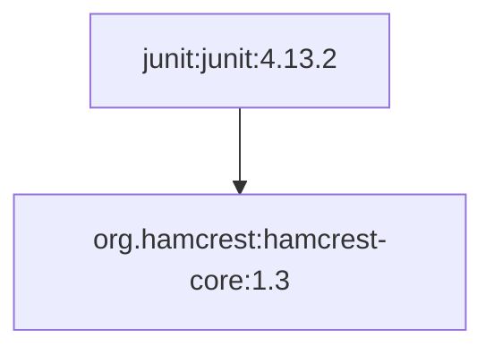
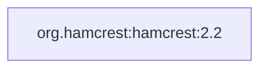
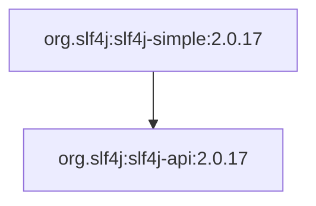

# Домашняя работа №2

**Вариант 22. Визуализация графа зависимостей Java Maven.**

```bash
cd homework_2
```

## Этап 1. Минимальный прототип с конфигурацией

Режим `config` показывает четыре настройки из `argparse`.
`--package` задаёт пакет, `--repository` задаёт адрес или файл.
`--test-repository` включает чтение файла, `--ascii-tree` выводит дерево.

```bash
bash run.sh --package junit:junit:4.13.2 \
  --repository https://repo.maven.apache.org/maven2/ --ascii-tree --mode config
```

```text
package=junit:junit:4.13.2
repository=https://repo.maven.apache.org/maven2/
test_repository=false
ascii_tree=true
```

<details>
<summary>Ошибки четырёх параметров</summary>

Фрагменты сообщений. Во всех случаях код завершения равен 2.

```bash
bash run.sh --package junit --repository https://repo.maven.apache.org/maven2/ --mode config
echo $?
```

`Ошибка: --package: ожидается groupId:artifactId[:version]`

```bash
bash run.sh --package junit:junit:4.13.2 --repository ftp://example.org --mode config
echo $?
```

`Ошибка: --repository: нужен HTTP(S) URL`

```bash
bash run.sh --package A --repository examples/chain.txt --test-repository=true --mode config
echo $?
```

`Ошибка: --test-repository: флаг передаётся без значения`

```bash
bash run.sh --package junit:junit:4.13.2 \
  --repository https://repo.maven.apache.org/maven2/ --ascii-tree=true --mode config
echo $?
```

`Ошибка: --ascii-tree: флаг передаётся без значения`

</details>

## Этап 2. Сбор данных

POM хранит настройки пакета Maven и его зависимости. Программа загружает
этот XML-файл через `urllib.request` и читает через `xml.etree.ElementTree`.

```bash
bash run.sh --package junit:junit:4.13.2 --repository https://repo.maven.apache.org/maven2/ --mode direct
```

```text
org.hamcrest:hamcrest-core:1.3
org.hamcrest:hamcrest-library:1.3
```

`direct` выводит все прямые зависимости, включая тестовую `hamcrest-library`.

## Этап 3. Основные операции

Обход в глубину (DFS) работает со стеком без рекурсии. В тестовом
графе каждый пакет раскрывается один раз, все связи сохраняются.

```bash
bash run.sh --package A --repository examples/chain.txt --test-repository --mode graph
```

```text
A: B
B: C
C:
```

<details>
<summary>Графы ромба и цикла</summary>

```bash
bash run.sh --package A --repository examples/diamond.txt --test-repository --mode graph
```

```text
A: B C
B: D
D:
C: D
```

```bash
bash run.sh --package A --repository examples/cycle.txt --test-repository --mode graph
```

```text
A: B
B: C
C: A
Цикл: C -> A
```

Цикл виден по ссылке из `C` на `A`, который ещё находится в стеке.

</details>

## Этап 4. Дополнительные операции

Пакет попадает в список после своих зависимостей. Начальный пакет
в список не входит.

```bash
bash run.sh --package A --repository examples/chain.txt --test-repository --mode order
```

```text
C
B
```

<details>
<summary>Порядок для ромба, цикла и JUnit. Сравнение с classpath</summary>

```bash
bash run.sh --package A --repository examples/diamond.txt --test-repository --mode order
```

```text
D
B
C
```

```bash
bash run.sh --package A --repository examples/cycle.txt --test-repository --mode order
echo $?
```

```text
Ошибка: порядок загрузки невозможен, есть цикл: C -> A
1
```

```bash
bash run.sh --package junit:junit:4.13.2 --repository https://repo.maven.apache.org/maven2/ --mode order
```

Для JUnit выводится `org.hamcrest:hamcrest-core:1.3`.

Maven 3.9.11 формирует classpath по [POM JUnit](homework_2/examples/maven/junit.xml).

```bash
mvn -f examples/maven/junit.xml dependency:build-classpath
```

Фрагмент фактического вывода с сокращёнными путями

```text
…/junit-4.13.2.jar:…/hamcrest-core-1.3.jar
```

`order` показывает порядок обхода. Classpath задаёт порядок поиска
классов и не показывает, в каком порядке скачались файлы.

</details>

## Этап 5. Визуализация

`graph.mmd` содержит схему Mermaid, `graph.html` открывает граф
в браузере. Фрагменты вывода ниже показывают ASCII-деревья.

**JUnit 4.13.2**

```bash
bash run.sh --package junit:junit:4.13.2 \
  --repository https://repo.maven.apache.org/maven2/ --ascii-tree --output output/junit
```



```text
junit:junit:4.13.2
`-- org.hamcrest:hamcrest-core:1.3
```

JUnit зависит от Hamcrest Core.

<details>
<summary>Графы Hamcrest и SLF4J Simple</summary>

**Hamcrest 2.2**

```bash
bash run.sh --package org.hamcrest:hamcrest:2.2 \
  --repository https://repo.maven.apache.org/maven2/ --ascii-tree --output output/hamcrest
```



```text
org.hamcrest:hamcrest:2.2
```

У Hamcrest 2.2 нет зависимостей в графе.

**SLF4J Simple 2.0.17**

```bash
bash run.sh --package org.slf4j:slf4j-simple:2.0.17 \
  --repository https://repo.maven.apache.org/maven2/ --ascii-tree --output output/slf4j
```



```text
org.slf4j:slf4j-simple:2.0.17
`-- org.slf4j:slf4j-api:2.0.17
```

SLF4J Simple зависит от SLF4J API той же версии.

</details>

Деревья трёх библиотек совпали с выводом Maven.

<details>
<summary>Команды Maven и фрагменты вывода</summary>

```bash
mvn -f examples/maven/junit.xml dependency:tree
```

```text
[INFO] demo:junit-check:jar:1
[INFO] \- junit:junit:jar:4.13.2:compile
[INFO]    \- org.hamcrest:hamcrest-core:jar:1.3:compile
```

```bash
mvn -f examples/maven/hamcrest.xml dependency:tree
```

```text
[INFO] demo:hamcrest-check:jar:1
[INFO] \- org.hamcrest:hamcrest:jar:2.2:compile
```

```bash
mvn -f examples/maven/slf4j.xml dependency:tree
```

```text
[INFO] demo:slf4j-check:jar:1
[INFO] \- org.slf4j:slf4j-simple:jar:2.0.17:compile
[INFO]    \- org.slf4j:slf4j-api:jar:2.0.17:compile
```

</details>

## Тестирование

```bash
python3 -B -m unittest discover -s tests -v
```

Фрагмент вывода одного запуска

```text
Ran 15 tests in 1.443s

OK
```

Тесты проверяют параметры, POM, графы, циклы, порядок обхода и визуализацию.
