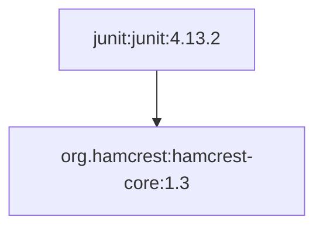
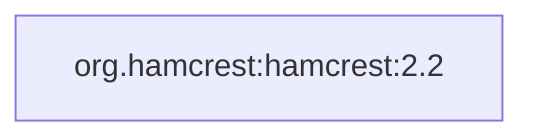
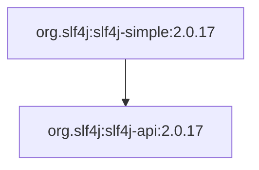

# Домашняя работа №2

**Вариант 22.** Граф зависимостей Java Maven.

Все команды запускаются из папки `homework_2`.

## Этап 1. Настройка программы

Для разбора командной строки я использовала `argparse`. Параметр `--package`
задаёт имя пакета, а `--repository` задаёт адрес репозитория или путь к файлу.
Флаг `--test-repository` включает чтение локального файла, а `--ascii-tree`
включает вывод текстового дерева при визуализации.

Программа проверяет координаты пакета, адрес HTTP(S) или доступность файла.
В тестовом режиме имена пакетов состоят из одной заглавной латинской буквы.
Неверные параметры приводят к сообщению об ошибке и коду завершения 2.

В режиме `config` программа выводит все четыре настройки:

```bash
bash run.sh --package junit:junit:4.13.2 \
  --repository https://repo.maven.apache.org/maven2/ \
  --ascii-tree --mode config
```

```text
package=junit:junit:4.13.2
repository=https://repo.maven.apache.org/maven2/
test_repository=false
ascii_tree=true
```

## Этап 2. Прямые зависимости

Из координат пакета программа составляет путь к POM-файлу. Например,
для JUnit это `junit/junit/4.13.2/junit-4.13.2.pom`. Файл загружается
через `urllib.request`, а XML разбирается через `xml.etree.ElementTree`.
Программа учитывает свойства, родительские POM и управляемые версии.
Если версия пакета пропущена, она берётся из `maven-metadata.xml`.

```bash
bash run.sh --package junit:junit:4.13.2 \
  --repository https://repo.maven.apache.org/maven2/ --mode direct
```

```text
org.hamcrest:hamcrest-core:1.3
org.hamcrest:hamcrest-library:1.3
```

Режим `direct` показывает прямые зависимости из POM, включая тестовые.

## Этап 3. Построение графа

Для поиска транзитивных зависимостей я использовала обход в глубину (DFS)
со стеком вместо рекурсии. Программа запоминает обработанные вершины,
сохраняет рёбра к общим зависимостям и отмечает циклы. В граф Maven попадают
зависимости из областей `compile` и `runtime` с учётом исключений.
Тестовые и необязательные зависимости в этот граф не входят.

Локальный файл задаёт список смежности. Строка `A: B` означает, что A
зависит от B. В примере ниже C снова ссылается на A:

```bash
bash run.sh --package A --repository examples/cycle.txt \
  --test-repository --mode graph
```

```text
A: B
B: C
C: A
Цикл: C -> A
```

## Этап 4. Порядок загрузки

Режим `order` выводит зависимость после обработки её собственных зависимостей.
Корневой пакет в список не входит. В тестовом ромбе A зависит от B и C,
а обоим нужен D, поэтому D выводится первым и только один раз.

```bash
bash run.sh --package A --repository examples/diamond.txt \
  --test-repository --mode order
```

```text
D
B
C
```

Для графа с циклом порядок построить нельзя, поэтому программа возвращает
код 1. Результат для JUnit я сравнила с `mvn dependency:tree` и
`dependency:build-classpath`. Maven подтвердил связь с Hamcrest Core.
В classpath JUnit указан раньше Hamcrest. Наш порядок показывает, какие
зависимости нужно обработать раньше использующего их пакета.

## Этап 5. Визуализация

### 1. Представление графа

Программа сохраняет описание диаграммы в `graph.mmd` и создаёт
`graph.html` для просмотра в браузере. Флаг `--ascii-tree` добавляет
текстовое дерево в терминале. Повторные вершины и циклы отмечаются
подписями `[уже показан]` и `[цикл]`.

```bash
bash run.sh --package junit:junit:4.13.2 \
  --repository https://repo.maven.apache.org/maven2/ --ascii-tree
```

### 2. Диаграммы для трёх пакетов







### 3. Сравнение с Maven

Для каждого из трёх пакетов я запустила `mvn dependency:tree` в отдельном
проекте. Если убрать из дерева Maven корень этого проекта, вершины и связи
совпадают с диаграммами. У JUnit есть зависимость от Hamcrest Core, у Hamcrest
2.2 зависимостей нет, а SLF4J Simple зависит от SLF4J API.

На более сложных POM результаты могут отличаться. В программе не реализованы
выбор версии по правилу ближайшей зависимости, профили и диапазоны версий.

## Вывод

Программа получает зависимости Java Maven из POM-файлов, строит граф без
рекурсии, обнаруживает циклы и показывает связи в Mermaid и ASCII.
Результаты запусков и тестов приведены в [протоколе проверки](homework_2/tests/RESULTS.md).
