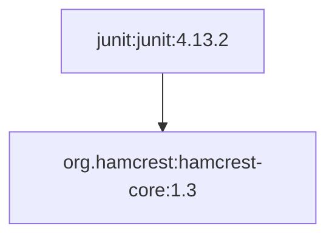
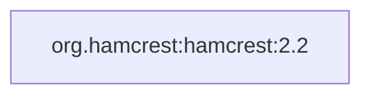
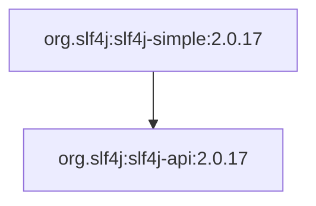

# Проверка этапа 1. Вариант 22

Дата: 11.11.2026. Все команды выполнены в `homework_2`.
Среда: macOS, Python 3.14.9.
stdout и stderr приведены вместе; ошибки CLI выводятся в stderr.

## Запуск 1

```bash
python3 -B -m unittest discover -s tests -v
```

Код завершения: `0`.

```text
test_coordinates_and_urls (test_cli.CliTests.test_coordinates_and_urls)
Принять координаты без версии, HTTP, порт и IPv6. ... ok
test_flag_misuse (test_cli.CliTests.test_flag_misuse)
Флаги не принимают true/false и другие отдельные значения. ... ok
test_help (test_cli.CliTests.test_help)
Справка доступна без обязательных параметров. ... ok
test_invalid_file (test_cli.CliTests.test_invalid_file)
Отклонить пустой путь, отсутствующий файл, каталог и file URL. ... ok
test_invalid_package (test_cli.CliTests.test_invalid_package)
Отклонить пустые, неполные и повреждённые координаты Maven. ... ok
test_invalid_test_package (test_cli.CliTests.test_invalid_test_package)
Тестовые имена должны состоять из одной большой латинской буквы. ... ok
test_invalid_url (test_cli.CliTests.test_invalid_url)
Отклонить неверную схему, сервер, порт и запрещённые части URL. ... ok
test_launcher_from_other_directory (test_cli.CliTests.test_launcher_from_other_directory)
Скрипт запуска работает с путями, содержащими пробелы. ... ok
test_missing_required_values (test_cli.CliTests.test_missing_required_values)
Проверить отсутствие каждого обязательного параметра и значения. ... ok
test_remote_ascii_setting (test_cli.CliTests.test_remote_ascii_setting)
Включение настройки дерева не запускает построение графа. ... ok
test_remote_defaults (test_cli.CliTests.test_remote_defaults)
Вывести все настройки, включая значения выключенных флагов. ... ok
test_source_mode_mismatch (test_cli.CliTests.test_source_mode_mismatch)
Отклонить URL в тестовом режиме и путь без тестового режима. ... ok
test_test_mode_flag_combinations (test_cli.CliTests.test_test_mode_flag_combinations)
Проверить тестовый источник с обоими состояниями ASCII-флага. ... ok
test_unreadable_file (test_cli.CliTests.test_unreadable_file)
Детерминированно проверить запрет чтения при любых правах ОС. ... ok
test_unsupported_options (test_cli.CliTests.test_unsupported_options)
Отклонить неизвестные опции, сокращения и поздние параметры. ... ok

----------------------------------------------------------------------
Ran 15 tests in 1.731s

OK
```

## Запуск 2

```bash
bash run.sh --package junit:junit:4.13.2 --repository https://repo.maven.apache.org/maven2/ --ascii-tree
```

Код завершения: `0`.

```text
package=junit:junit:4.13.2
repository=https://repo.maven.apache.org/maven2/
test_repository=false
ascii_tree=true
```

## Запуск 3

```bash
bash run.sh --package A --repository examples/repository.txt --test-repository
```

Код завершения: `0`.

```text
package=A
repository=examples/repository.txt
test_repository=true
ascii_tree=false
```

## Запуск 4

```bash
python3 -B src/main.py --package A --repository examples/repository.txt --test-repository
```

Код завершения: `0`.

```text
package=A
repository=examples/repository.txt
test_repository=true
ascii_tree=false
```

## Запуск 5

```bash
bash run.sh --help
```

Код завершения: `0`.

```text
usage: main.py [-h] --package PACKAGE --repository REPOSITORY
               [--test-repository] [--ascii-tree]

Maven: этап 1, только проверка и вывод конфигурации.

options:
  -h, --help            show this help message and exit
  --package PACKAGE     groupId:artifactId[:version]; в тестовом режиме буква
                        A-Z
  --repository REPOSITORY
                        HTTP(S) URL или путь к файлу при --test-repository
  --test-repository     использовать локальный тестовый файл; значение не
                        требуется
  --ascii-tree          сохранить настройку ASCII-дерева; значение не
                        требуется
```

## Запуск 6

```bash
bash run.sh --repository https://repo.maven.apache.org/maven2/
```

Код завершения: `2`.

```text
usage: main.py [-h] --package PACKAGE --repository REPOSITORY
               [--test-repository] [--ascii-tree]
Ошибка: не указаны обязательные параметры: --package
Справка: --help
```

## Запуск 7

```bash
bash run.sh --package junit:junit
```

Код завершения: `2`.

```text
usage: main.py [-h] --package PACKAGE --repository REPOSITORY
               [--test-repository] [--ascii-tree]
Ошибка: не указаны обязательные параметры: --repository
Справка: --help
```

## Запуск 8

```bash
bash run.sh --package junit:junit --repository
```

Код завершения: `2`.

```text
usage: main.py [-h] --package PACKAGE --repository REPOSITORY
               [--test-repository] [--ascii-tree]
Ошибка: параметр --repository: требуется одно значение
Справка: --help
```

## Запуск 9

```bash
bash run.sh --package /bad --repository https://repo.maven.apache.org/maven2/
```

Код завершения: `2`.

```text
usage: main.py [-h] --package PACKAGE --repository REPOSITORY
               [--test-repository] [--ascii-tree]
Ошибка: --package: ожидается groupId:artifactId[:version] без пробелов
Справка: --help
```

## Запуск 10

```bash
bash run.sh --package junit:junit --repository ftp://example.org/
```

Код завершения: `2`.

```text
usage: main.py [-h] --package PACKAGE --repository REPOSITORY
               [--test-repository] [--ascii-tree]
Ошибка: --repository: нужен HTTP(S) URL; для файла нужен тестовый режим
Справка: --help
```

## Запуск 11

```bash
bash run.sh --package A --repository missing.txt --test-repository
```

Код завершения: `2`.

```text
usage: main.py [-h] --package PACKAGE --repository REPOSITORY
               [--test-repository] [--ascii-tree]
Ошибка: --repository: файл не существует или путь указывает на каталог
Справка: --help
```

## Запуск 12

```bash
bash run.sh --package A --repository https://example.org/ --test-repository
```

Код завершения: `2`.

```text
usage: main.py [-h] --package PACKAGE --repository REPOSITORY
               [--test-repository] [--ascii-tree]
Ошибка: --repository: тестовый режим требует путь к файлу, а не URL
Справка: --help
```

## Запуск 13

```bash
bash run.sh --package junit:junit --repository examples/repository.txt
```

Код завершения: `2`.

```text
usage: main.py [-h] --package PACKAGE --repository REPOSITORY
               [--test-repository] [--ascii-tree]
Ошибка: --repository: нужен HTTP(S) URL; для файла нужен тестовый режим
Справка: --help
```

## Запуск 14

```bash
bash run.sh --package A --repository examples/repository.txt --test-repository=false
```

Код завершения: `2`.

```text
usage: main.py [-h] --package PACKAGE --repository REPOSITORY
               [--test-repository] [--ascii-tree]
Ошибка: параметр --test-repository: флаг не принимает значение 'false'
Справка: --help
```

## Запуск 15

```bash
bash run.sh --package A --repository examples/repository.txt --ascii-tree=maybe
```

Код завершения: `2`.

```text
usage: main.py [-h] --package PACKAGE --repository REPOSITORY
               [--test-repository] [--ascii-tree]
Ошибка: параметр --ascii-tree: флаг не принимает значение 'maybe'
Справка: --help
```

## Оформление кода

`pycodestyle 2.15.0`, предел 79 символов: код 0, замечаний нет.
`sh -n run.sh`: код 0.


# Итоговая проверка этапов 1-5

Дата: 17.11.2026. Среда: macOS, Python 3.14.9.
Предыдущие результаты выше относятся к версии первого этапа.
В текущей программе её поведение доступно через `--mode config`.

## Автоматические тесты

```bash
python3 -B -m unittest discover -s tests -v
```

Код завершения 0. Последние строки реального протокола:

```text

----------------------------------------------------------------------
Ran 44 tests in 3.595s

OK
```

Покрыты CLI, разбор POM, parent, свойства, BOM с собственными свойствами,
управляемые exclusions, metadata, сетевые ошибки, тестовый репозиторий,
DFS, циклы, порядок, Mermaid, ASCII и запись HTML.
Пять интеграционных тестов запускают настоящий CLI и локальный HTTP-сервер.
Открытие браузера проверяется через mock, без заявления о реальном рендеринге.

## Реальные команды программы

```bash
bash run.sh --package A --repository examples/repository.txt --test-repository --mode config
```

Код завершения: `0`.

```text
package=A
repository=examples/repository.txt
test_repository=true
ascii_tree=false
```

```bash
bash run.sh --package junit:junit:4.13.2 --repository https://repo.maven.apache.org/maven2/ --mode direct
```

Код завершения: `0`.

```text
org.hamcrest:hamcrest-core:1.3
org.hamcrest:hamcrest-library:1.3
```

```bash
bash run.sh --package A --repository examples/chain.txt --test-repository --mode order
```

Код завершения: `0`.

```text
C
B
```

```bash
bash run.sh --package A --repository examples/diamond.txt --test-repository --mode order
```

Код завершения: `0`.

```text
D
B
C
```

```bash
bash run.sh --package A --repository examples/leaf.txt --test-repository --mode order
```

Код завершения: `0`.

```text
Зависимостей нет.
```

```bash
bash run.sh --package A --repository examples/cycle.txt --test-repository --mode order
```

Код завершения: `1`.

```text
Ошибка: порядок загрузки невозможен, есть цикл: C -> A
```

```bash
bash run.sh --package A --repository examples/cycle.txt --test-repository --ascii-tree --no-open --output /tmp/cm-maven-comparison/cycle/view
```

Код завершения: `0`.

```text
flowchart TD
    n0["A"]
    n1["B"]
    n2["C"]
    n0 --> n1
    n1 --> n2
    n2 --> n0
A
`-- B
    `-- C
        `-- A [цикл]
Диаграмма: /private/tmp/cm-maven-comparison/cycle/view/graph.html
Цикл: C -> A
```

## Maven Central и сравнение

Реальные обращения выполнены для `junit:junit:4.13.2`,
`org.hamcrest:hamcrest:2.2`, `org.slf4j:slf4j-simple:2.0.17`.
Для каждого создан отдельный POM с одной зависимостью.
Apache Maven 3.9.11, Java 26.0.1, maven-dependency-plugin 3.8.1.
Команды `tree` и `build-classpath` завершились `BUILD SUCCESS`.
Пример POM и команды сравнения приведены в конце протокола.

Сохранённый вывод Maven:

### junit

```text
demo:comparison:jar:1
\- junit:junit:jar:4.13.2:compile
   \- org.hamcrest:hamcrest-core:jar:1.3:compile
```

Classpath в порядке Maven, без локальных путей:

```text
junit-4.13.2.jar
hamcrest-core-1.3.jar
```

Собственный Mermaid-исходник:



### hamcrest

```text
demo:comparison:jar:1
\- org.hamcrest:hamcrest:jar:2.2:compile
```

Classpath в порядке Maven, без локальных путей:

```text
hamcrest-2.2.jar
```

Собственный Mermaid-исходник:



### slf4j-simple

```text
demo:comparison:jar:1
\- org.slf4j:slf4j-simple:jar:2.0.17:compile
   \- org.slf4j:slf4j-api:jar:2.0.17:compile
```

Classpath в порядке Maven, без локальных путей:

```text
slf4j-simple-2.0.17.jar
slf4j-api-2.0.17.jar
```

Собственный Mermaid-исходник:



## Проверка оформления всего репозитория

```bash
pycodestyle --max-line-length=80 src tests homework_2/src homework_2/tests
radon cc src tests homework_2/src homework_2/tests -s -n C
sh -n homework_2/run.sh
bash -n run.sh tests/test_all.sh tests/test_script.sh tests/test_vfs.sh \
  tests/test_vfs_minimal.sh tests/test_vfs_multiple.sh tests/test_vfs_nested.sh
```

Команды выполнены из корня репозитория, коды 0, замечаний нет.
Использованы pycodestyle 2.15.0 и Radon 6.0.1.
Дополнительно проведена проверка AST и Python-токенов по требованиям методички:

- Проверено Python-файлов: 18.
- Самая длинная функция: 34 строки при пределе 40.
- Максимальная цикломатическая сложность: 10 при пределе 10.
- Docstring есть у всех модулей, классов и функций.
- Комментариев в Python-коде нет.
- Строк Python длиннее 80 символов, функций с более чем 7 аргументами нет.
- Большие числовые литералы в сравнениях не найдены.
- Генерируемые HTML, архивы и двоичные файлы в Git не добавлены.

Проверка первой домашней работы выполнена отдельно во временном каталоге:
созданы три VFS-архива, проверены количество записей, содержимое и SHA-256.
Команды `ls`, `cd`, неизвестная команда, `vfs-info`, `exit` проверены
с подменой только Tkinter; настоящее графическое окно не запускалось.
Результат: `OK`.

## Оставшиеся ограничения

Политика проверочного браузера запрещает `file://`, поэтому фактический
рендеринг HTML на экране не подтверждён. Файлы Mermaid и HTML сформированы,
проверены тестами; три Mermaid-диаграммы включены в основной отчёт.

Историческое замечание C6 остаётся. Найдено 20 старых коммитов без нужного
Conventional/Scoped-формата. Они сохранены, опубликованная история не переписана.
Новые коммиты соответствуют формату. Допуск преподавательской проверкой
в этом протоколе не заявляется.


## POM и команды сравнения с Maven

Для каждого пакета использован отдельный проект с одной зависимостью.
Пример POM для JUnit:

```xml
<project xmlns="http://maven.apache.org/POM/4.0.0">
  <modelVersion>4.0.0</modelVersion>
  <groupId>demo</groupId>
  <artifactId>comparison</artifactId>
  <version>1</version>
  <dependencies>
    <dependency>
      <groupId>junit</groupId>
      <artifactId>junit</artifactId>
      <version>4.13.2</version>
    </dependency>
  </dependencies>
</project>
```

Для Hamcrest и SLF4J Simple заменены координаты зависимости.
Команды сравнения для этих двух пакетов:

```bash
mvn -B -ntp -f /tmp/cm-maven-comparison/hamcrest/pom.xml \
  org.apache.maven.plugins:maven-dependency-plugin:3.8.1:tree \
  org.apache.maven.plugins:maven-dependency-plugin:3.8.1:build-classpath \
  -Dscope=runtime -DincludeScope=runtime \
  -DoutputFile=/tmp/cm-maven-comparison/hamcrest/tree.txt \
  -Dmdep.outputFile=/tmp/cm-maven-comparison/hamcrest/classpath.txt
mvn -B -ntp -f /tmp/cm-maven-comparison/slf4j-simple/pom.xml \
  org.apache.maven.plugins:maven-dependency-plugin:3.8.1:tree \
  org.apache.maven.plugins:maven-dependency-plugin:3.8.1:build-classpath \
  -Dscope=runtime -DincludeScope=runtime \
  -DoutputFile=/tmp/cm-maven-comparison/slf4j-simple/tree.txt \
  -Dmdep.outputFile=/tmp/cm-maven-comparison/slf4j-simple/classpath.txt
```
